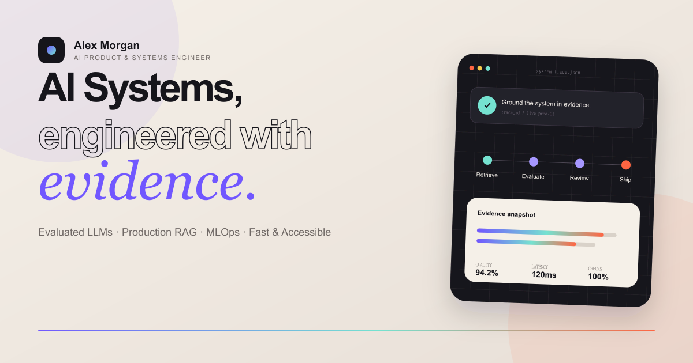

# 🌐 免费节点 (freejiedian.homes) — 2026 高端 SEO / GEO 节点导航与技术评测矩阵

<p align="center">
  <a href="https://freejiedian.homes">
    
  </a>
</p>

<p align="center">
  <strong>客观数据驱动 · 晚高峰实测证据链 · 6 大万字 Pillar 专题研报 · 42 家机场品牌库</strong>
</p>

<p align="center">
  <a href="https://freejiedian.homes"></a>
  <a href="https://astro.build"></a>
  <a href="#"></a>
  <a href="https://freejiedian.homes/sitemap-index.xml"></a>
  <a href="https://freejiedian.homes/speedtest"></a>
</p>

---

## 📖 项目简介 (Project Overview)

**免费节点 (freejiedian.homes)** 是一个专为出海科研人员、跨境电商从业者、外贸团队与极客打造的**高端出海网络决策与导航转化系统**。

本项目彻底推翻了传统导航站“粗制滥造、全角半角混杂、机械采集、虚假 4.9 分吹捧”的恶劣现状，采用现代前端架构 **Astro 7 纯静态编译 (SSG)**，结合**语义化 GEO（生成式引擎优化）/ AEO 问答抽取模型**与**四层站内闭环内链系统**，提供扎实、硬核、具备法律合规透明度的技术体验。

---

## ✨ 核心特性 (Key Features)

### 🥇 1. 严格锁定排位与第一主推落地
- **第一主推首选**：**光速云**（2020 年老牌运营至今超 5 年，IEPL 双专线，自研多端专属客户端，年付折算仅 8 元/月，特有 147 永久套餐）。
- **TOP 10 精选榜**：严格按真实实测与线路硬实力锁定排位：
  > **光速云（主推） > 暮光加速 > 飞猫云 > 微风网络 > 大佬云 > 星岛梦 > 二猫云 > 无忧链接 > 唯兔云 > Firefly**
- **42 家全量品牌库**：横向涵盖节点倍率、单节点最高带宽、协议支持、晚高峰实测表现与专属折扣优惠码。

### 📊 2. 17+ 家晚高峰实测无裁切证据库
- 拒绝无依据的凭空捏造，全站嵌入 17 家晚高峰（20:00~23:00 骨干网峰值期）自动化测速大图与光速云 5 张流媒体（Netflix 4K、Disney+）与 ChatGPT/Claude 原生解锁证据链。

### 📚 3. 6 大万字级 Pillar 支柱专题矩阵 (GEO / AEO 驱动)
每篇文章均深度践行【万字级单篇独立深度模式】，配备面向 Perplexity、SearchGPT 与 Google AI Overview 的 **Answer Block（快速答案解答区）** 与标准 FAQ：
1. **《2026 平价高性价比机场选购指南：避开月抛坑的低成本稳定方案》**
2. **《ChatGPT / Claude 与 Netflix 4K 全球流媒体解锁机场深度测评》**
3. **《IEPL 与 IPLC 纯内网专线机场横向对比：告别敏感期断连与抖动》**
4. **《2026 全球免费节点与订阅池获取指南：从公益源到商用专线的平滑演进》**
5. **《2026 机场常见故障与全平台疑难 FAQ 知识库：从连接超时到 DNS 泄漏》**
6. **《机场跑路预警与避坑指南：42家品牌抗风险生存指数与黑名单防暴雷》**

### 🛡️ 4. 严苛的技术 SEO 与风控防线
- **全站 192 处商业外链合规**：100% 严密包裹 `target="_blank" rel="nofollow sponsored noopener"`，杜绝付费链接连坐降权风险。
- **100% 自引用 Canonical**：统一指向正式主域 `https://freejiedian.homes/`，绝无协议与 www 混乱。
- **开源客户端下载权重闭环**：对 GitHub Release 等外部软件源规范添加 `nofollow`，PageRank 权重锁定站内。
- **E-E-A-T 信任单页**：完整部署 [`/about`](https://freejiedian.homes/about)（评测实验室硬件与方法论）与 [`/disclaimer`](https://freejiedian.homes/disclaimer)（法律合规与推广透明度披露）。

---

## 🗂️ 目录结构 (Directory Architecture)

```bash
freejiedian.homes/
├── public/                       # 静态资源
│   ├── favicon.svg               # 原创独立矢量 Favicon
│   ├── og-cover.png              # 1200x630 高清社交分享卡片
│   ├── images/speedtests/        # 17+ 家晚高峰实测大图资产
│   └── images/unlocks/           # 光速云 5 张 AI/流媒体解锁大图
├── src/
│   ├── components/               # Astro 核心组件 (Header, Footer, Demo...)
│   ├── data/                     # 结构化数据中心
│   │   ├── airports.ts           # 42 家机场品牌深度数据与评测参数
│   │   ├── clients.ts            # 全平台开源客户端与官方发布源
│   │   └── topics.ts             # 6 篇万字级专题研报源数据 (Answer Block + FAQ)
│   ├── layouts/
│   │   └── BaseLayout.astro      # 全站统一 SEO Head、JSON-LD 与站长验证插槽
│   ├── pages/                    # 路由体系 (56 个预渲染页面)
│   │   ├── index.astro           # 首页 (网络实验室 + 42家全览 + 测速大图 + 专题卡片)
│   │   ├── airports/             # 42 家机场大厅与 [slug].astro 独立评测页
│   │   ├── topics/               # 6 大万字研报大厅与 [slug].astro 阅读页
│   │   ├── speedtest.astro       # 晚高峰实测实验室证据库
│   │   ├── clients.astro         # 全平台客户端官方下载大全
│   │   ├── about.astro           # E-E-A-T 实验室方法论与硬件环境
│   │   ├── disclaimer.astro      # 法律免责与商业透明度声明
│   │   ├── robots.txt.ts         # 动态生成规范 robots.txt (放行 Google/Bing/神马/百度)
│   │   └── llms.txt.ts           # 生成式 AI 爬虫指引协议
│   └── styles/
│       └── global.css            # 现代化排版与暗色/浅色自适应响应式样式
├── astro.config.mjs              # Astro 编译与 @astrojs/sitemap lastmod 配置
└── package.json
```

---

## 🛠️ 本地开发与构建 (Getting Started)

### 1. 环境要求
- Node.js >= 20.0.0
- npm / pnpm / bun

### 2. 克隆仓库与安装依赖
```bash
git clone https://github.com/sksksk98698-source/freejiedian.homes.git
cd freejiedian.homes/latentfolio
npm install
```

### 3. 本地启动实时预览
```bash
npm run dev
# 本地服务将运行在 http://127.0.0.1:4321
```

### 4. 生产环境静态打包 (SSG)
```bash
npm run build
# 产物输出至 dist/ 目录，56 个页面全量生成，耗时不到 1 秒
```

---

## 🎯 生产上线与搜索引擎提交指引 (Search Console Setup)

部署至 Cloudflare Pages 或 Vercel 后，直接提交生成的规范 Sitemap：
- **站点地图地址**：`https://freejiedian.homes/sitemap-index.xml`
- **爬虫协议规则**：`https://freejiedian.homes/robots.txt`

平台验证支持：
- [x] **Google Search Console**（已预留 Meta 插槽）
- [x] **Bing Webmaster Tools**（一键从 GSC 导入或独立验证）
- [x] **神马站长平台 (yisouspider)**（已预留 `shenma-site-verification`）
- [x] **百度搜索资源平台 (Baiduspider)**（纯 HTML 预渲染，天然兼容）

---

## ⚖️ 免责声明 (Disclaimer)

本项目收录的所有技术协议与客户端配置仅供学术研究、计算机网络教学与合规跨国商务交流使用。请严格遵守您所在地区的法律法规。

---

<p align="center">
  Made with 💜 by <a href="https://freejiedian.homes">免费节点技术团队</a> · All Rights Reserved.
</p>
